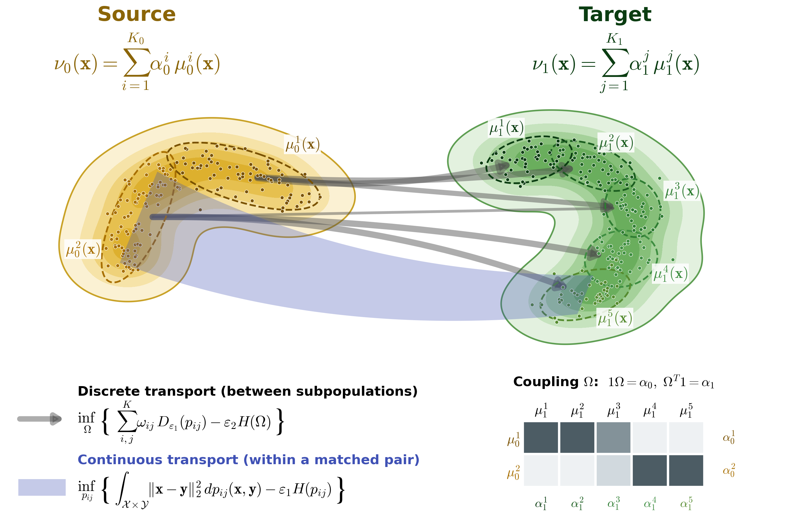

# OMT: Optimal Mixture Transport


> **A Biconvex Formulation for Stable Transport of Mixture Models with a Unique Solution**
> Yeganeh Marghi, Kelly Jin, Uygar Sümbül — Allen Institute, Brain Science
> *40th Conference on Neural Information Processing Systems (NeurIPS 2026)*

**Optimal Mixture Transport (OMT)** is a scalable framework that shifts the transport paradigm from individual samples to mixtures of subpopulations, reformulating the transport problem as a strictly biconvex optimization with a unique global minimizer.

- **Strictly biconvex with a unique solution.** Entropic regularization at the component level (ε₁) and at the mixing-weight level (ε₂) turns the non-convex mixture-transport objective into a strictly biconvex problem (Lemma 1). The GOP algorithm reaches its unique global minimizer in a single iteration (Theorem 1).
- **Stable.** Under weak regularity conditions, which hold for unbounded densities, the OMT map is Lipschitz and tilt-stable. Bounded perturbations of the marginals produce bounded changes in the map (Theorem 2).
- **Scalable.** Each subpopulation is an exponential-family component (Gaussian, `p=q=2`, or asymmetric Laplace / double-exponential, `p=q=1`). These have closed-form component-to-component maps, so the cost scales with the number of components, `O(K₀K₁)`, rather than with the number of samples.

<p align="center">
  
</p>

## Method at a glance

As the figure shows, OMT models the source and target as mixtures of subpopulations,

```
ν_0(x) = Σ_{i=1..K0} α_0^i · μ_0^i(x),        ν_1(y) = Σ_{j=1..K1} α_1^j · μ_1^j(y)
```

and solves the transport problem at two coupled levels:

1. **Discrete transport between subpopulations (grey arrows).** A component-coupling matrix Ω = [ω_ij] (K₀×K₁) decides how much mass each source component sends to each target component. Its marginals must match the mixing weights: `1Ω = α_0`, `Ωᵀ1 = α_1`.
2. **Continuous transport within each matched pair (blue band).** For each pair (i, j), a local plan p_ij moves μ_0^i to μ_1^j at entropic Wasserstein cost `D_ε1(p_ij) = ∫ ‖x − y‖² dp_ij(x, y) − ε₁ H(p_ij)`.

Both levels are optimized jointly through the OMT objective (Eq. 7–8):

```
min_{Ω, P}   Σ_ij  ω_ij · D_ε1(p_ij)  −  ε₂ · H(Ω)
s.t.         1Ω = α_0,   Ωᵀ1 = α_1,   p_ij marginals consistent with μ_0^i, μ_1^j
```

The resulting OMT map is a barycentric combination of closed-form component maps (Eq. 9):

```
T_omt(x) = Σ_ij  ω̃_ij(x) · T_ij(x),     ω̃_ij(x) = ω_ij · μ_0^i(x) / ν_0(x)
```

**Component families (Eq. 11–13).** Each μ is a piecewise (possibly asymmetric) exponential density with tail exponents p, q:

- `p = q = 2`: Gaussian components. T_ij and p_ij are the closed-form Gaussian (Bures–Wasserstein) solutions, and the OMT coupling is itself a GMM with K₀K₁ components (Corollary 1).
- `p = q = 1`: factorized asymmetric Laplace (double-exponential) components. T_ij is computed per dimension as `F_1j⁻¹(F_0i(x_k))` (CDF → quantile), in the same way as sliced OT.

---

## Repository structure

```
OMT/
├── README.md
├── figures/                    # README figures (method diagram)
├── omt/                        # The OMT library
│   ├── src/
│   │   ├── general_solver.py   # Main entry point: omt(), mm_ot(), mixture fitting, point transport
│   │   ├── exp_functions.py    # Asymmetric exponential (p,q ∈ {1,2}) components: EM fitting,
│   │   │                       #   closed-form W2 costs, CDF/quantile maps, points_transport()
│   │   ├── exp_functions_gpu.py# GPU (PyTorch) versions of the exponential-family routines
│   │   ├── omt_mix.py          # Mixture-model classes (DoubleExponential, ...)
│   │   ├── functions.py        # Gaussian/Bures-Wasserstein utilities, entropy, MMD, transport cost
│   │   ├── utils.py            # Synthetic data generators (GMMs, shapes, SPD matrices)
│   │   ├── fid.py              # FID evaluation for image experiments
│   │   └── omt_exp_w2.py       # Driver for the Wasserstein-2 benchmark
│   └── examples/
│       └── distributions.py    # Toy source/target distributions for quick demos
│
└── experiments/                # Scripts and notebooks that reproduce the paper
    ├── Synthetic/              # §5 "Impact of mixture parameterization" (Fig. 1, 6, 7)
    ├── W2benchmark/            # §5 "Stability under noise" on the W2 benchmark (App. D, Fig. 2, 8–12)
    ├── sci-Plex/               # §5 single-cell drug perturbation, human scRNA-seq (Table 1, Fig. 13)
    ├── MERFISH/                # §5 spatial alignment of mouse brain slices (Table 2, Fig. 4, 14, 15)
    ├── MNIST/                  # §5 / App. F.1 unpaired image-to-image translation, MNIST & CIFAR-10 (Fig. 5, 20, Table 7)
    └── ImageNet/               # §5 / App. F.2 high-dimensional alignment (Table 3)
```

### `omt/` — library

| Module | Role |
|---|---|
| `general_solver.py` | `omt(data_source, data_target, ...)` fits source/target mixtures and solves the OMT problem. Also contains `mm_ot` (solver on pre-fitted mixtures), `gmm_fitting`, `sample_mm`, baseline `ot_w2` / `ot_sinkh`, and `points_transport_mm`. |
| `exp_functions.py` | Factorized asymmetric exponential components (Eq. 12): `em_mixture`, `exp_fitting`, `vectorized_W2_cost_matrix`, and `points_transport` (the barycentric map in Eq. 9 and Eq. 13). |
| `exp_functions_gpu.py` | Torch/CUDA counterparts for large datasets. |
| `functions.py`, `utils.py` | Shared math utilities and synthetic data generation. |
| `fid.py` | FID metric for image tasks. |

### `experiments/` — reproducing the paper

Each subfolder is self-contained. **Planned contents:** a short `README.md` (data source, preprocessing, and how to run), the scripts or notebooks, and a `configs/` or parameter block holding the settings used in the paper.

| Folder | Paper section | Data | Baselines | Main outputs | Paper settings | Status |
|---|---|---|---|---|---|---|
| `Synthetic/` | §5, App. C | 2D/3D shapes (circles, star, cube, cross, rings, half-moon, …) | — | Fig. 1, 6, 7 | Gaussian (K_G up to 100) vs. Laplace (K_Exp) components | `5_circles.ipynb`, `12_star.ipynb`, `8_cube.ipynb`, `simulations.ipynb` |
| [`W2benchmark/`](experiments/W2benchmark) | §5, App. D | Wasserstein-2 benchmark [Korotin et al.], d ∈ {2,16,64,128,256}, n = 10k–50k, 10k test samples | W2-OT, ExNOT, ENOT, PROGOT, GMM-OT | Fig. 2, 8–12 (noise robustness, runtime, OMT vs. GMM-OT, component ablation) | p=q=2: (K₀,K₁)=(3,15); p=q=1: (10,30); 10 seeds | run scripts for OMT and all baselines (see folder README) |
| `sci-Plex/` | §5, App. E.4 | sci-Plex3: A549/K562/MCF7, 5 drugs, 24 h (77,920 cells, 34,636 genes) → PCA | EOT, HiRef, PROGOT, GMM-OT | Table 1, Fig. 13, Tables 4–5 | (K₀,K₁)=(3,5), ε₁=ε₂=0.01, d_PCA=16, 5 seeds | *to be added* |
| `MERFISH/` | §5, App. E.3/E.5 | Vizgen MERFISH Mouse Brain Receptor Map, 2 slices (85,958 / 84,172 cells), spatial (x, y) only | HiRef, GMM-OT | Table 2, Fig. 4, 14, 15, Table 6 | (K₀,K₁)=(1000,1000) Gaussian components | `fit_components.py`, `aligment_task.ipynb` |
| `MNIST/` | §5, App. F.1 | MNIST (conv. dual-decoder VAE, d_z=10) and CIFAR-10 (DoubleResNet, d_z=32) | WGAN, WGAN-GP (FID) | Fig. 5, 20, Table 7 | K=10 per side, ε=0.01, 10 seeds | *to be added* |
| `ImageNet/` | §5, App. F.2 | ImageNet ILSVRC, 2048-d ResNet-50 embeddings, 2 × 640,500 images | Mini-batch OT, FRLC, HiRef | Table 3 | 1000 components per side, diagonal covariance | *to be added* |

> The mouse brain development (visual cortex, E11.5–P28, 32,998 cells) and ageing (adult vs. aged oligodendrocyte lineage, 253,468 cells) analyses in Fig. 3, 16–19 and App. E.6 will go in a separate folder, e.g. `experiments/MouseBrain/`. OMT is trained on 10-d VAE embeddings with 5–25 components, roughly twice the number of known cell types at each timepoint.

### Data sources (App. E.1)

- **sci-Plex3:** NCBI GEO [GSE139944](https://www.ncbi.nlm.nih.gov/geo/query/acc.cgi?acc=GSE139944)
- **MERFISH Mouse Brain Receptor Map:** [Vizgen](https://info.vizgen.com/mouse-brain-map)
- **Mouse visual cortex development (10x scRNA-seq):** NeMO, [dat-0oyried](https://assets.nemoarchive.org/dat-0oyried)
- **Mouse ageing (10x scRNA-seq):** NeMO, [dat-61kfys3](https://assets.nemoarchive.org/dat-61kfys3)
- **W2 benchmark, MNIST, CIFAR-10, ImageNet:** public benchmarks; see the respective experiment folders.

Large data files (`*.h5ad`, `*.pkl`) are git-ignored. Each experiment README should explain how to download or regenerate its data.

---

## Installation

```bash
git clone https://github.com/AllenInstitute/OMT.git
cd OMT
pip install numpy scipy scikit-learn pot cvxpy joblib matplotlib torch
# W2 benchmark / PROGOT baselines additionally need:
pip install jax ott-jax
```

The modules in `omt/src` currently import each other by bare module name, so add the folder to your path:

```python
import sys; sys.path.append("omt/src")
```

## Quick start

```python
import numpy as np
import sys; sys.path.append("omt/src")
from general_solver import omt, points_transport_mm

X_src = np.random.randn(5000, 2)              # source samples
X_tgt = np.random.randn(5000, 2) * 0.5 + 3.0  # target samples

# fitting_mode: 'gauss' (p=q=2, GMM), 'exp' (asymmetric exponential), or 'mix'
omt_w, solver = omt(
    X_src, X_tgt,
    n_components=(3, 15),   # (K0, K1)
    eps_gmm=0.1,            # component-level entropic regularization (ε1)
    eps_w=0.0,              # mixing-matrix entropic regularization (ε2)
    method='cvx',           # 'cvx' | 'sinkhorn' | 'w2'
    fitting_mode='gauss',
    random_seed=0,
)

X_mapped = points_transport_mm(X_src, omt_w, solver)   # T_omt(x)
```

`omt_w` is the K₀×K₁ component-coupling matrix Ω. `solver` holds the fitted mixtures (`mm_s`, `mm_t`), timings, and iteration counts.

---

## Highlights from the paper

**sci-Plex (Table 1).** Sinkhorn divergence D_ε ↓, d_PCA = 16, mean over 5 seeds.

| Method | Belinostat | Dacinostat | Givinostat | Quisinostat | Hesperadin |
|---|---|---|---|---|---|
| EOT | 17.4 | 18.4 | 17.5 | 17.6 | 17.5 |
| HiRef | 19.9 | 24.0 | 19.2 | 22.8 | 17.3 |
| PROGOT | 8.4 | 8.8 | 8.8 | 9.5 | 8.1 |
| GMM-OT (3, 5) | 8.0 | 8.9 | 8.9 | 8.8 | 8.1 |
| **OMT (3, 5)** | **7.9** | **8.1** | **8.7** | **8.7** | **8.0** |

**MERFISH (Table 2).** Cosine similarity ↑ of imputed marker-gene expression, and spatial Euclidean cost ↓. The map is fit on cell spatial coordinates only.

| Method | Slc17a7 | Grm4 | Olig1 | Gad1 | Peg10 | Cost |
|---|---|---|---|---|---|---|
| HiRef | 0.81 | 0.80 | 0.75 | 0.49 | 0.60 | 330.33 |
| GMM-OT (1000, 1000) | 0.89 | 0.90 | 0.90 | 0.73 | 0.73 | 107.20 |
| **OMT (1000, 1000)** | **0.90** | **0.93** | **0.90** | **0.78** | **0.75** | **101.69** |

**ImageNet alignment (Table 3).** Alignment cost ↓ and class-preserving kNN accuracy ↑.

| Method | Cost | top-1 / top-5 (%) |
|---|---|---|
| Mini-batch OT (B=1024) | 19.58 | 39.63 / 77.38 |
| FRLC (r=1000) | 24.12 | 8.45 / 31.50 |
| HiRef | 18.97 | 40.09 / 61.39 |
| **OMT (1000)** | **14.30** | **84.45 / 98.59** |

On the W2 benchmark (Fig. 2, 9), OMT degrades least under both Gaussian and dropout noise in the source data. Its advantage is largest under non-Gaussian (dropout) perturbations.

---

## Citation

```bibtex
@inproceedings{marghi2026omt,
  title     = {A Biconvex Formulation for Stable Transport of Mixture Models with a Unique Solution},
  author    = {Marghi, Yeganeh and Jin, Kelly and S{\"u}mb{\"u}l, Uygar},
  booktitle = {Advances in Neural Information Processing Systems (NeurIPS)},
  year      = {2026}
}
```
