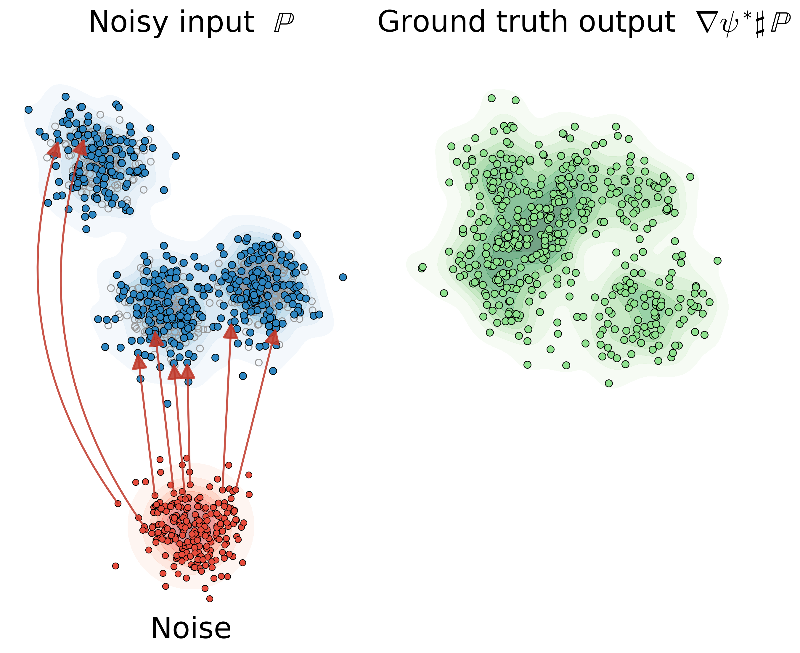

# W2 benchmark: stability of OT solvers under noise

This folder contains the code for the Wasserstein-2 benchmark experiments in the paper: §5 *"Stability under noise"*, App. D, Fig. 2 and Fig. 8–12.

<p align="center">
  
</p>

## The stability study (briefly)

We use the continuous **Mix3toMix10** task from the Wasserstein-2 benchmark of Korotin et al. [1, 2]. The source ℙ is a 3-component Gaussian mixture. The target is the push-forward ∇ψ\*♯ℙ through a known, pretrained convex potential ψ\*, so the ground-truth OT map ∇ψ\* is available for every sample.

To test robustness (Theorem 2), each solver is fit on **perturbed source samples**: the blue points in the figure are clean samples (grey) shifted by noise (red). Each solver is then evaluated on a **clean** test set of 10,000 samples against the ground-truth map. Two perturbation types are used:

- **Additive Gaussian noise** 𝒩(0, σ²I), σ ∈ {0.1, 0.25, 0.5, 1.0}
- **Dropout noise**: each feature is zeroed with probability p ∈ {0.05, 0.1, 0.25, 0.5}. This mimics gene dropout in single-cell data.

The reported quantity is the relative increase in MSE (ΔMSE, %) over the noise-free fit, averaged over 10 random initializations, for d ∈ {2, 16, 64, 128, 256} with n = 10k / 20k / 30k / 50k / 50k training samples. OMT degrades least under both noise types, and its margin is largest under the non-Gaussian dropout noise (Fig. 2, 9).

## Contents

```
W2benchmark/
├── src/        # Benchmark code from Korotin et al. [1]: map_benchmark (Mix3ToMix10Benchmark), ICNNs,
│               #   samplers, L2-UVP / cosine metrics, plotting
├── omt/        # Earlier OMT solver version imported by the baseline scripts (omt.solver, omt.functions[_])
├── omtnew/     # Snapshot of the OMT library (general_solver, exp_functions, ...) used for the W2 runs
└── scripts/    # Run scripts, one per method
```

| Script | Method | Paper setting |
|---|---|---|
| [`omt/src/omt_exp_w2.py`](../../omt/src/omt_exp_w2.py) (in the library) | **OMT** | ε₁ = ε₂ = 0.01, CVX solver, exponential components, diagonal scales |
| `scripts/gmm-omt.py` | OMT vs. GMM-OT under input perturbation | App. D.4, Fig. 11 |
| `scripts/gmmot.py` | GMM-OT | (K₀, K₁) = (3, 15), unregularized W2 coupling |
| `scripts/progot.py` | PROGOT (OTT-JAX) | exponential α-schedule, tuned ε-schedule |
| `scripts/eot.py` | EOT / Sinkhorn (OTT-JAX) | ε = 0.1 |
| `scripts/w2ot.py` | W2-OT (amortized ICNN neural dual, OTT-JAX) | |
| `scripts/ernot.py` | ExNOT (expectile-regularized neural OT, OTT-JAX) | |
| `scripts/enot.py`, `scripts/enot_inv.py` | ENOT (SDE-based entropic neural OT), forward / inverse training | |
| `scripts/enot_post.py` | ENOT evaluation of saved forward/inverse models over the noise grid | |

Each run writes `metrics.npy` (MMD, L2, L2-UVP, cosine similarity, Sinkhorn divergence, runtime, CPU/GPU memory) to `./results/<method>/<experiment-name>/`.

## Running

1. **Get the benchmark potentials.** Download the pretrained Mix3toMix10 checkpoints from [Wasserstein2Benchmark](https://github.com/iamalexkorotin/Wasserstein2Benchmark) and place them so they resolve as `./benchmarks/Mix3toMix10/{dim}_v1.pt` and `{dim}_v2.pt`, relative to the directory you run from.
2. **Install dependencies:** `numpy scipy scikit-learn pandas pot cvxpy joblib torch jax ott-jax optax flax wandb`. A CUDA GPU is required (`GPU_DEVICE = 0`).
3. **Run from this folder**, with it on the path:

```bash
cd experiments/W2benchmark
PYTHONPATH=. python scripts/gmmot.py          # baselines: same pattern for the other scripts/*.py
PYTHONPATH=. python ../../omt/src/omt_exp_w2.py # OMT
```

Dimensions, sample sizes, number of components, regularization, and repetitions are set as constants at the top of each script.

## References

If you use this benchmark, please also cite:

[1] A. Korotin, L. Li, A. Genevay, J. Solomon, A. Filippov, E. Burnaev. *Do Neural Optimal Transport Solvers Work? A Continuous Wasserstein-2 Benchmark.* NeurIPS 2021. Code: <https://github.com/iamalexkorotin/Wasserstein2Benchmark>

[2] M. Cuturi et al. *Optimal Transport Tools (OTT): A JAX Toolbox for all things Wasserstein.* Implementations of the PROGOT, EOT, W2-OT and ExNOT baselines. <https://github.com/ott-jax/ott>

```bibtex
@inproceedings{korotin2021neural,
  title     = {Do Neural Optimal Transport Solvers Work? A Continuous Wasserstein-2 Benchmark},
  author    = {Korotin, Alexander and Li, Lingxiao and Genevay, Aude and Solomon, Justin M and Filippov, Alexander and Burnaev, Evgeny},
  booktitle = {Advances in Neural Information Processing Systems},
  volume    = {34},
  pages     = {14593--14605},
  year      = {2021}
}
```
